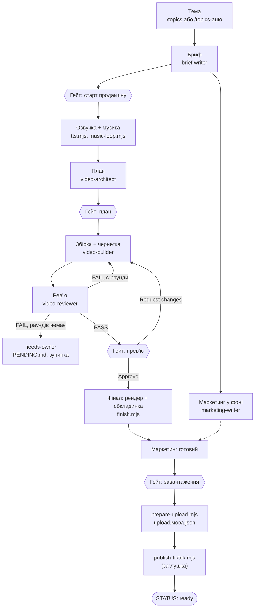
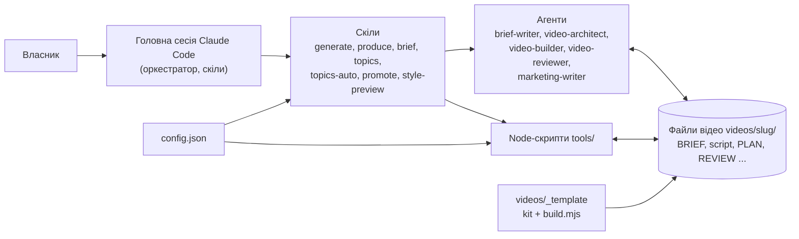
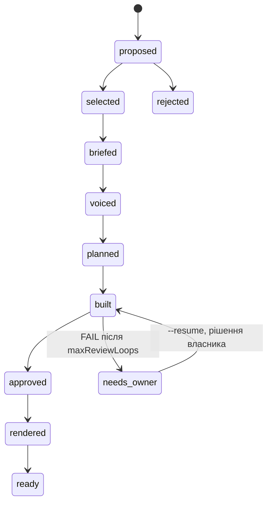
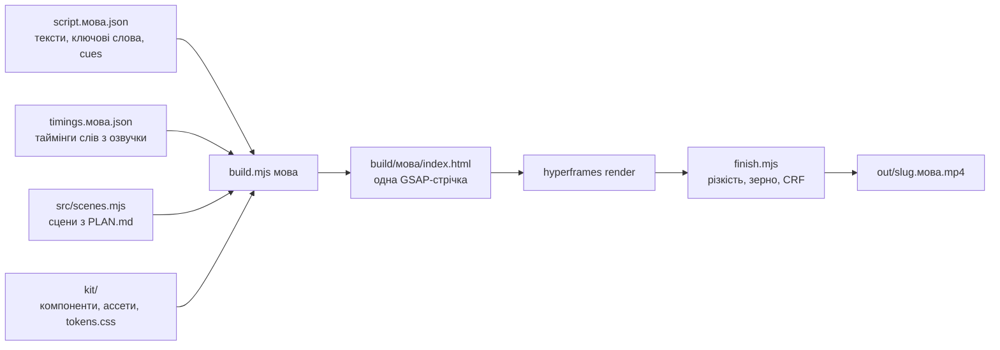
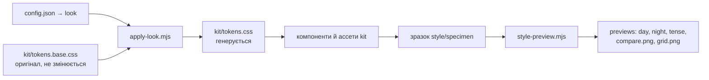

# TikTok Videomaker

Проєкт на базі **Claude Code**, який перетворює тему («igloo», «katana», «yakhchal», «roman aqueduct») на готове вертикальне відео **60–120 секунд** (MP4, 1080×1920, 30 fps) про те, як працює простий винахід, інструмент або споруда. Кожна деталь конструкції показана за схемою **проблема → що ламається без неї → рішення**. Наприкінці кожного відео звучить фраза «Now you know how to build a …».

Ти робиш лише три речі: обираєш тему, запускаєш команду і схвалюєш прев'ю. Решту — дослідження фактів, сценарій, озвучку, план монтажу, збірку, перевірку якості, фінальний рендер, обкладинку, текст допису для TikTok і файл для завантаження — роблять скіли, агенти та Node-скрипти.

> Автоматично публікувати в TikTok проєкт **не вміє** (є лише заглушка `publish-tiktok`): він готує все для ручного завантаження.

## Зміст
1. [Що вміє проєкт](#що-вміє-проєкт)
2. [Швидкий старт](#швидкий-старт)
3. [Як користуватися](#як-користуватися)
4. [Як це працює (діаграми)](#як-це-працює-діаграми)
5. [Команди (скіли)](#команди-скіли)
6. [Агенти](#агенти)
7. [Інструменти `tools/`](#інструменти-tools)
8. [Конфігурація `config.json`](#конфігурація-configjson)
9. [Гейти, статуси, відновлення](#гейти-статуси-відновлення)
10. [Стиль: `look` і `/style-preview`](#стиль-look-і-style-preview)
11. [Маркетинг і файл для завантаження](#маркетинг-і-файл-для-завантаження)
12. [Логи](#логи)
13. [Структура репозиторію](#структура-репозиторію)
14. [Як змінити й адаптувати під себе](#як-змінити-й-адаптувати-під-себе)
15. [Часті проблеми](#часті-проблеми)
16. [Документація](#документація)

---

## Що вміє проєкт

| Етап | Що відбувається | Результат |
| --- | --- | --- |
| Теми | 10 нових тем з оцінками (1–5) і посиланням на Вікіпедію | `topics.md` |
| Бриф | Дослідження фактів з джерелами, розкадровка, сценарій для кожної мови | `BRIEF.md`, `script.<мова>.json`, `voiceover.<мова>.txt` |
| Озвучка | ElevenLabs з часовими мітками слів (або твій власний mp3) | `audio/voice.<мова>.mp3`, `timings.<мова>.json` |
| План | Технічний план: сцени, ассети, компоненти, команди | `PLAN.md` |
| Збірка | Сцени на HyperFrames (HTML + GSAP) за даними сценарію й таймінгами озвучки | чернетка `out/draft/` |
| Перевірка | Рев'юер дивиться кадри чернетки й пише вердикт PASS/FAIL | `REVIEW.md` |
| Прев'ю | Ти дивишся чернетку й схвалюєш або просиш правок | — |
| Фінал | Рендер, обкладинка, фінальна обробка (різкість, зерно, віньєтка) | `out/<slug>.<мова>.mp4`, `out/cover.<мова>.png` |
| Маркетинг | Підпис, хештеги, ключові слова, закріплений коментар | `marketing.<мова>.json`, `MARKETING.md` |
| Завантаження | Файл у форматі TikTok Content Posting API | `out/upload.<мова>.json` |

Ключові принципи:
- **Усі тексти на екрані** беруться зі `script.<мова>.json`, **усі таймінги** — з `timings.<мова>.json` (з озвучки), нічого не прописується в розмітці вручну. Тому нова мова — це лише нові дані, без змін коду.
- **Факти мають джерела** в `BRIEF.md`; пояснення, яких немає в джерелах, позначені як інженерні.
- **Єдиний стиль** для всіх відео: low-poly з плоскою заливкою, вид збоку в розрізі, кумулятивний кадр, ляльки з блоків, «привид невдачі» перед кожним рішенням (див. `docs/style-guide.md`).
- **Ключ ElevenLabs** живе лише в `.env`; Claude його не читає, скрипти беруть його через `node --env-file=.env`.

---

## Швидкий старт

### 1. Що встановити (один раз)
- **Node.js 22+** і **FFmpeg** (`node -v`, `ffmpeg -version`, `ffprobe -version`). Python не потрібен.
- **Claude Code**.
- Плагін **HyperFrames**:
  ```bash
  claude plugin marketplace add heygen-com/hyperframes
  claude plugin install hyperframes@hyperframes
  ```
  (або в Claude Code: `/plugin marketplace add heygen-com/hyperframes`, потім `/plugin install hyperframes@hyperframes`). CLI зафіксований на версії `hyperframes@0.9.36`.
- Для завантаження репозиторію на GitHub (за бажанням) — `gh`.

### 2. Налаштування
1. Клонуй репозиторій і відкрий його в терміналі.
2. Створи `.env`: скопіюй `.env.example` → `.env` і впиши `ELEVENLABS_API_KEY=...` (ElevenLabs → профіль → API Keys). Файл у `.gitignore`.
3. У `config.json → tts.voices` впиши `voice_id` голосу для кожної мови (ElevenLabs → Voices → голос → «Copy voice ID»).
4. За бажанням поклади `assets/music.mp3` — фоновий луп (10–30 с) для всіх відео. Немає файлу — немає музики.
5. Увімкни захист від витоку ключів:
   ```bash
   git config core.hooksPath .githooks
   ```
   Хук `.githooks/pre-commit` блокує коміт, у якому є ключ виду `sk_…` або файл `.env`.
6. Запусти `claude` у папці проєкту. Шаблон відео (`videos/_template/`) уже в репозиторії; `BOOTSTRAP_PROMPT.md` потрібен лише якщо шаблон треба відновити з нуля.

### 3. Перше відео
```text
/generate
```
Скіл покаже 10 тем, ти обереш номер, далі він проведе відео через усі етапи й зупинятиметься лише там, де потрібне твоє схвалення.

---

## Як користуватися

**Найпростіше — одна команда:**

| Що робиш | Команда |
| --- | --- |
| Усе відео від теми до файлу для завантаження | `/generate` |
| Те саме без жодних питань (усі гейти схвалення відкриті лише на цей запуск) | `/generate --unattended` |
| Продовжити перерване відео (ліміт токенів, збій, зупинка) | `/generate --resume` або `/generate --resume <slug>` |

**Крок за кроком (ручні блоки):**

| Крок | Команда | Що робить |
| --- | --- | --- |
| 1 | `/topics` | 10 тем з оцінками й посиланнями; відповідаєш `3` або `3 uk ru` |
| 2 | `/brief <тема> [uk] [ru]` | бриф і сценарії (запускається сам після вибору теми) |
| 3 | `/produce <slug> [мови]` | озвучка → план → збірка → рев'ю → прев'ю → фінал → маркетинг → файл для завантаження |

**Інші сценарії:**
- **Додати мову до готового відео:** `/brief <slug> uk`, потім `/produce <slug> uk`.
- **Своя озвучка без API:** поклади `videos/<slug>/audio/voice.<мова>.mp3` до `/produce`; таймінги візьмуться з пауз у звуці.
- **Змінити озвучку:** `/produce <slug> --revoice` (витрачає кредити ElevenLabs).
- **Реєстр тем:** відповідь `reject 2,5` на `/topics` назавжди прибирає теми.
- **Підтягнути покращення компонентів у шаблон:** `/promote <slug>`.
- **Налаштувати картинку без рендеру відео:** `/style-preview` (див. [нижче](#стиль-look-і-style-preview)).
- **Автоматично обрати тему:** `/topics-auto` (бере тему з найвищим сумарним балом і одразу робить бриф).

Готові файли лежать у `videos/<slug>/out/`: `<slug>.<мова>.mp4`, `cover.<мова>.png`, `upload.<мова>.json`; текст допису, хештеги й закріплений коментар — у `videos/<slug>/MARKETING.md`.

---

## Як це працює (діаграми)

### Загальний конвеєр


### Хто за що відповідає

Головна сесія лише оркеструє: запускає скрипти, делегує роботу агентам, перевіряє їхні файли й питає власника. Агенти не питають і не викликають один одного: кожна передача — це **файл** (`BRIEF.md` → `PLAN.md` → код → `REVIEW.md`).

### Статуси відео

Статус записано в `videos/<slug>/STATUS` і в `topics.md`. `needs_owner` на схемі — це статус `needs-owner`.

### Як дані перетворюються на відео

Cue-слова зі сценарію (наприклад «wall» → `wall-rise`) прив'язують анімації до слів озвучки, тож синхронізація працює в кожній мові.

### Конвеєр стилю


---

## Команди (скіли)

Скіли лежать у `.claude/skills/<назва>/SKILL.md` і викликаються як `/назва`.

| Команда | Аргументи | Що робить |
| --- | --- | --- |
| `/generate` | `[--unattended] [--resume [<slug>]]` | Одне відео від теми до `ready`: тема → бриф → маркетинг у фоні → гейт → озвучка → план → збірка ⇄ рев'ю → прев'ю → фінал → маркетинг → файл для завантаження. Зупиняється лише на гейтах, які `config.json` залишає закритими. |
| `/produce` | `<slug> [мови] [--revoice] [--unattended] [--resume]` | Продакшн готового брифу (кроки P1–P9; ту саму логіку використовує `/generate`). |
| `/brief` | `<тема або slug> [uk] [ru]` | Створює `videos/<slug>/` з шаблону, викликає `brief-writer`, перевіряє `validate.mjs`. Режими: нове відео, додати мову, правки за нотатками власника. |
| `/topics` | `[тема або категорія]` | 10 нових тем (макс. 2 на категорію), оцінки 1–5 за hook / visual / depth / facts / variety, посилання на Вікіпедію (колонка Wiki). Далі відповідаєш номером, назвою (+ мови) або `reject 2,5`. |
| `/topics-auto` | `[тема або категорія]` | Те саме, але сам обирає тему з найвищою сумою (при рівності — категорію, яку найдавніше використовували), записує `auto-picked: причина` у `topics.md`. |
| `/promote` | `<slug>` | Показує зміни `kit/` і `build.mjs` у відео порівняно з шаблоном, питає, які з них перенести в `videos/_template/`, коміт `template: promote from <slug>`. |
| `/style-preview` | `[key=value …] [key=v1,v2,v3] [--neutral] [--apply] [--guides]` | Стоп-кадри «зразка» (день, ніч, напруга) для значень `look`, порівняння з попереднім прев'ю. Відео не рендериться. |

Скіли `/generate`, `/promote` і `/style-preview` запускає лише власник. `/topics`, `/topics-auto`, `/brief` і `/produce` можуть викликатися й з `/generate`, тому вони не мають `disable-model-invocation`. `/promote` у `--unattended`-запуску не викликається, а його «Auto mode» (лише загальні сумісні зміни, без питань) виконується в кінці `/produce`, якщо `autoPromoteKit` = `true`.

---

## Агенти

Агенти лежать у `.claude/agents/`. Вони **не ставлять питань**, а все записують у файли.

| Агент | Модель | Роль | Пише |
| --- | --- | --- | --- |
| `brief-writer` | Opus | Досліджує тему в мережі (≥ 2 незалежні джерела на кожен факт), будує ланцюжок «проблема → рішення», пише розкадровку й сценарії | `BRIEF.md`, `script.<мова>.json`, `voiceover.<мова>.txt` |
| `video-architect` | Opus, medium, без shell | Технічний план для збірки (сцени за beat'ами, ассети, компоненти, команди з `TEMPLATE.md`) | `PLAN.md` |
| `video-builder` | Sonnet, medium | Реалізує план у HyperFrames; режими `build`, `fix`, `final` | `src/`, `build/`, `out/draft/`, `out/` |
| `video-reviewer` | Sonnet, medium | Дивиться кадри чернетки за чекліст-ом (технічні параметри, кадри beat'ів, субтитри, safe zones, кольори) | `REVIEW.md` (PASS/FAIL) |
| `marketing-writer` | Sonnet, low, без web і shell | Підпис, хештеги, ключові слова, закріплений коментар, варіанти для Shorts/Reels | `marketing.<мова>.json`, `MARKETING.md` |

---

## Інструменти `tools/`

Node 22 без npm-залежностей (потрібні лише `ffmpeg`/`ffprobe`). Усі запускаються з кореня репозиторію.

| Скрипт | Для чого |
| --- | --- |
| `tts.mjs <slug> <мова> [--force]` | Озвучка ElevenLabs з часовими мітками символів; повторно використовує збережене аудіо, якщо текст не змінився. Запуск: `node --env-file=.env tools/tts.mjs …` |
| `timings-from-silence.mjs <slug> <мова>` | Таймінги за паузами у власному mp3 (без API) |
| `music-loop.mjs <slug> <мова>` | Підганяє музичний луп під тривалість відео (нічого не робить, якщо немає `assets/music.*`) |
| `fake-voice.mjs <slug> <мова>` | Тиха «озвучка» з синтетичними таймінгами для тестів без кредитів (`source: fake`, у фінал не йде) |
| `new-video.mjs <slug>` | Створює `videos/<slug>/` з шаблону без згенерованих папок (build, out, audio, showcase, style); використовує `/brief`, без `rm` |
| `validate.mjs <slug>` | Перевірка сценаріїв, таймінгів, а також `marketing.*.json` і `upload.*.json`, якщо вони є. Для `en` помилка, якщо слів > (target − 8) × 2.4 |
| `script-hash.mjs <slug> <мова>` | sha256 усього тексту озвучки (для виявлення застарілого маркетингу) |
| `prepare-upload.mjs <slug> <мова>` | Збирає `out/upload.<мова>.json`; код виходу 3 = маркетинг застарів (текст змінився) |
| `publish-tiktok.mjs <slug> <мова>` | Заглушка: перевіряє `upload.*.json`; при `publish: "off"` пише, що файл готовий |
| `finish.mjs <файл> [<вихід>]` | Фінальна обробка відео чи PNG за `look` (різкість, зерно, віньєтка, CRF, x264 tune) |
| `apply-look.mjs [--set k=v] [--neutral]` | Генерує `kit/tokens.css` з `tokens.base.css` і `config.look` |
| `style-preview.mjs …` | Рушій скіла `/style-preview` |
| `wiki-lookup.mjs "<назва>" [--lang en]` | Шукає статтю у Вікіпедії, друкує `{title, url, found}` |
| `log.mjs` | Додає рядок у лог відео або лог запусків (час проставляє скрипт) |
| `lib.mjs` | Спільні функції (не запускається) |

---

## Конфігурація `config.json`

`config-template.json` — значення за замовчуванням. Скрипти читають `config.json`, **накладений поверх шаблону**: якщо ключа немає в `config.json`, береться значення з шаблону. Тому не створюй `config.json` з нуля: якщо файлу немає — скопіюй шаблон; нові ключі додавай у шаблон.

### `languages`
| Ключ | Значення | Що змінює |
| --- | --- | --- |
| `primary` | `en` | Основна мова: на ній пишуться брифи й плани, чернетки рев'юються англійською |
| `supported` | `["en","uk","ru"]` | Мови, які дозволені в `script.<мова>.json` |

### `tts` — озвучка (ElevenLabs)
| Ключ | Типово | Що змінює |
| --- | --- | --- |
| `provider` | `elevenlabs` | Постачальник озвучки |
| `model` | `eleven_multilingual_v2` | Модель; підтримує англійську, українську, російську |
| `outputFormat` | `mp3_44100_128` | Формат аудіо |
| `voices` | один `voice_id` на мову | Голос для кожної мови — **впиши свій** |
| `voiceSettings` | stability 0.5, similarity_boost 0.75, style 0, use_speaker_boost true, speed 1 | Налаштування голосу. Параметр `speed` для цього голосу практично не скорочує аудіо: якщо відео задовге, скорочуй сценарій |
| `maxRetries` | `2` | Скільки разів повторювати запит при помилці |

### `timing` — тривалість і таймінги
| Ключ | Типово | Що змінює |
| --- | --- | --- |
| `minDurationSec` / `maxDurationSec` | 60 / 120 | Межі тривалості відео; довше за максимум — відео не рендериться |
| `tailSec` | 1.5 | Пауза після озвучки до кінця відео |
| `silenceDetect` | noiseDb −35, minSilenceSec 0.25 | Параметри пошуку пауз для власного mp3 (без API) |

### `music`
| Ключ | Типово | Що змінює |
| --- | --- | --- |
| `volume` | 0.12 | Гучність музики під голосом |
| `fadeInSec` / `fadeOutSec` | 1 / 2 | Наростання й затухання |

### `pipeline` — автоматизація й гейти
| Ключ | Типово | Що змінює |
| --- | --- | --- |
| `defaultLanguages` | `["en"]` | Мови для `/generate` і `/topics-auto` |
| `autoSelectTopic` | `false` | `true` — тему обирає скіл за найвищим балом, без питання |
| `autoStartProduction` | `false` | `true` — після брифу одразу йде озвучка |
| `autoApprovePlan` | `false` | `true` — іде далі після `PLAN.md` без схвалення |
| `maxReviewLoops` | `2` | Скільки раундів рев'ю можуть запускати виправлення (рев'юер працює щонайменше раз) |
| `autoApprovePreview` | `false` | `true` — фінальний рендер без твого прев'ю, **лише** якщо останнє рев'ю = PASS |
| `autoPrepareUpload` | `false` | `true` — готує `upload.<мова>.json` без питання |
| `asyncMarketing` | `true` | Маркетинг-агент стартує у фоні одразу після брифу |
| `autoPromoteKit` | `false` | `true` — сам переносить покращення компонентів у шаблон |
| `publish` | `"off"` | Лише `off` (у планах: draft / private / public) |

`false` = скіл питає тебе (**Approve / Request changes**).

### `marketing` — налаштування допису TikTok
| Ключ | Типово | Що змінює |
| --- | --- | --- |
| `privacyLevel` | `SELF_ONLY` | Видимість допису (`SELF_ONLY`, `MUTUAL_FOLLOW_FRIENDS`, `FOLLOWER_OF_CREATOR`, `PUBLIC_TO_EVERYONE`) |
| `disableDuet` / `disableStitch` / `disableComment` | `false` | Заборона дуетів, stitch, коментарів |
| `isAigc` | `true` | Мітка «AI-generated» |
| `alsoShortsAndReels` | `true` | Чи писати ще варіанти для Shorts і Reels |

### `look` — зовнішній вигляд
Описано в розділі [Стиль](#стиль-look-і-style-preview).

---

## Гейти, статуси, відновлення

**Гейти схвалення** — п'ять місць, де конвеєр може зупинитися й спитати тебе:

| Гейт | Прапорець | Де |
| --- | --- | --- |
| тема | `autoSelectTopic` | `/generate`: `true` → `/topics-auto`, `false` → `/topics` і твій вибір |
| продакшн | `autoStartProduction` | після брифу, до озвучки (щоб не витрачати кредити без потреби) |
| план | `autoApprovePlan` | після `PLAN.md` |
| прев'ю | `autoApprovePreview` | після PASS, до фінального рендеру |
| завантаження | `autoPrepareUpload` | після фіналу й маркетингу |

- Прапорець `true` → гейт проходить сам; `false` → питання **Approve / Request changes**.
- **`/generate --unattended`**: лише на цей запуск усі гейти схвалення вважаються `true`. У `config.json` нічого не пишеться; `publish` і `autoPromoteKit` завжди беруться з `config.json`.
- **Жорстке правило** (його не обходить жоден прапорець чи `--unattended`): якщо останнє рев'ю = **FAIL** після `maxReviewLoops` — конвеєр зупиняється, `STATUS` = `needs-owner`, причина в `videos/<slug>/PENDING.md`.
- **`--resume [<slug>]`** продовжує з того місця, де зупинилося (без slug — найостанніше незавершене відео). Готові кроки не повторюються, кредити ElevenLabs не витрачаються повторно. Для `needs-owner` скіл покаже відкриті зауваження й спитає **Approve anyway / Request changes**; з `--unattended` такі відео автоматично не проходять.
- Перед завершенням чи зупинкою оркестратор чекає на фонові агенти (асинхронний маркетинг).
- **У `--unattended` ніщо не чекає на відповідь.** Блокуючі помилки (немає ключа, валідація, збій інструмента) пишуть `PENDING.md`, не змінюють `STATUS` і зупиняють запуск; `--resume` повторює невдалий крок. Озвучка довша за 120 с автоматично скорочується один раз (`brief-writer` і нова озвучка — це витрачає кредити).

**Рев'ю-цикл:** рев'юер завжди працює щонайменше раз; при FAIL збирач виправляє, і рев'юер перевіряє знову (до `maxReviewLoops` виправлень). Після твого прев'ю дрібні правки (текст, позиція, колір, швидкість) робить збирач, а структурні (додати/прибрати сцени, змінити концепцію) — спершу архітектор, потім збирач.

---

## Стиль: `look` і `/style-preview`

Картинку налаштовуєш на **стоп-кадрах**, без рендеру відео. Скіл збирає «зразок» (`videos/_template/style/specimen/`: усі ассети й оверлеї у трьох станах — день, ніч, напруга), робить кадри, застосовує ту саму фінальну обробку (різкість, зерно, віньєтка) і кладе їх у `videos/_template/style/previews/<дата_час>/` (`day.png`, `night.png`, `tense.png`, `look.json`, `compare.png` — попереднє зліва, нове справа). Папка `previews` у `.gitignore`.

| Що | Команда |
| --- | --- |
| Кадри за поточним `config.json → look` | `/style-preview` |
| Базова (оригінальна) палітра | `/style-preview --neutral` |
| Спробувати значення, не зберігаючи | `/style-preview saturation=1.2 depthFade=0.5` |
| Порівняти кілька значень (колонка = значення, рядки день і ніч) | `/style-preview lightness=1.0,1.1,1.2` |
| Зберегти в `config.json` і закомітити | `/style-preview saturation=1.2 --apply` |
| Показати safe-zone напрямні | `/style-preview --guides` |

| Ключ | Діапазон | Типово | Що змінює |
| --- | --- | --- | --- |
| `saturation` | 0–2 | 1.10 | насиченість кольорів сцени |
| `lightness` | 0.5–1.5 | 1.10 | яскравість кольорів сцени |
| `maxLightness` | 0.5–1 | 0.94 | стеля яскравості (сніг лишається відмінним від білого тексту) |
| `contrast` | 0.5–1.5 | 1.0 | контраст сцени |
| `temperature` | −1…1 | 0 | холодніше / тепліше |
| `faceShading` | 0–1 | 0.5 | різниця світлих і темних граней (0.5 = як було) |
| `outline` | 0–6 | 0 | товщина контуру навколо полігонів, px |
| `shadowOpacity` | 0–1 | 0.25 | тіні під об'єктами |
| `depthFade` | 0–1 | 0.3 | далекі шари «тануть» у небо |
| `nightDarkness` / `nightBlue` | 0–0.8 / 0–1 | 0.35 / 0.5 | наскільки ніч темніша / синіша |
| `uiScale` | 0.7–1.4 | 1.0 | розмір плашок, виносок, шкал |
| `captionScale` | 0.7–1.3 | 1.0 | розмір субтитрів |
| `captionShadow` | 0–2 | 0.6 | тінь субтитрів |
| `sharpen` | 0–1.5 | 0.3 | різкість у фінальному рендері (0 = вимкнено) |
| `crf` / `x264Tune` | 10–30 / animation… | 18 / animation | якість і тюнінг кодека фіналу |
| `grain` / `vignette` | 0–1 | 0 / 0 | зерно / віньєтка (0 = вимкнено) |

Як це влаштовано:
- `kit/tokens.base.css` — оригінальна палітра (інструменти її не змінюють). `kit/tokens.css` **генерується** `apply-look.mjs` з нього й `config.look`. Файл `tokens.css` руками не редагуй: міняй `config.json` або запускай `/style-preview … --apply`.
- Кольори UI зі значенням (зелений, червоний, жовтий, синій, помаранчевий «тепло», білий, приглушений) `look` не змінює.
- Чернетки без фінальної обробки; фінал і обкладинка обробляються автоматично (`tools/finish.mjs`). Повний опис: `docs/style-guide.md` → «Look parameters».
- Нове відео бере поточний `kit/tokens.css` із шаблону; уже готові відео мають власну копію й не змінюються.

---

## Маркетинг і файл для завантаження

- `marketing-writer` пише для кожної мови `marketing.<мова>.json` (підпис ≤ 2200 символів, бажано ≤ 300; 3–6 хештегів; 5–8 ключових слів; закріплений коментар із фактом, якого немає у відео, і назвою джерела) і спільний `MARKETING.md` з готовим до вставки підписом і чеклістом завантаження. Факти беруться лише з `BRIEF.md`.
- У файлі маркетингу зберігається **хеш тексту озвучки**. Якщо текст змінився, `prepare-upload.mjs` завершується з кодом 3 («stale marketing»), і маркетинг перегенеровується.
- `prepare-upload.mjs` пише `out/upload.<мова>.json` з полями, що відповідають TikTok Content Posting API (Direct Post): `post_info` (title, privacy_level, disable_duet/stitch/comment, video_cover_timestamp_ms, brand_content_toggle, brand_organic_toggle, is_aigc), `source_info`, розмір і тривалість відео. Обкладинка береться з середини кульмінаційного beat'а. Схеми: `docs/marketing.schema.json`, `docs/upload.schema.json`.
- Публікація вимкнена: `publish: "off"`. Завантажуй відео вручну, використовуючи `MARKETING.md`. Опис майбутнього API-потоку — у коментарі на початку `tools/publish-tiktok.mjs`.

---

## Логи

Два журнали, обидва лише дописуються й обидва в `.gitignore`. Рядок має вигляд `час | slug | крок | результат | деталі`; **час проставляє скрипт `tools/log.mjs`**, а не модель, і пишуть їх лише скіли (оркестратор), не агенти.

| Журнал | Де | Що містить |
| --- | --- | --- |
| Лог відео | `videos/<slug>/logs/pipeline.log` | детальна історія одного відео: початок і кінець кожного кроку, рішення на гейтах (авто / схвалено / правки), символи TTS по мовах, вердикт рев'ю в кожному раунді, зупинки `needs-owner`, `--resume`, помилки з текстом, шляхи результатів |
| Лог запусків | `logs/runs.log` у корені | коротко: початок і кінець кожної команди (`/generate`, `/produce`, `/brief`, `/topics`, `/topics-auto`, `/promote`, `/style-preview`) зі slug, прапорцями, фінальним статусом і тривалістю; події без папки відео мають slug `-` |

Додати рядок вручну:
```bash
node tools/log.mjs <slug> <крок> <результат> "<деталі>"          # лог відео
node tools/log.mjs --run <команда> <slug|-> <результат> "<деталі>"  # лог запусків
```

---

## Структура репозиторію

```text
CLAUDE.md                 правила проєкту для Claude Code
config.json               твої налаштування (поверх config-template.json)
config-template.json      значення за замовчуванням
topics.md                 реєстр тем: статус, оцінки, посилання
.env                      ключ ElevenLabs (не в git)
assets/                   необов'язковий music.mp3 (не в git)
docs/                     PRD, ARCHITECTURE, style-guide, tech-requirements, storytelling,
                          brief-template, схеми JSON, приклад examples/yakhchal/
tools/                    Node-скрипти (див. вище)
.claude/skills/           скіли (команди)
.claude/agents/           агенти
.claude/settings.json     дозволи: node tools/*, ffmpeg, npx hyperframes …; заборонено читати .env і git push
.githooks/pre-commit      захист від витоку ключів
logs/runs.log             лог запусків (не в git)
videos/_template/         шаблон відео: HyperFrames-проєкт + kit + build.mjs + зразок стилю
videos/<slug>/            одне відео
```

Папка відео:
```text
videos/<slug>/
  BRIEF.md  script.<мова>.json  voiceover.<мова>.txt   бриф і тексти
  timings.<мова>.json                                  таймінги (з озвучки)
  PLAN.md  REVIEW.md  STATUS  PENDING.md                план, рев'ю, статус, причина зупинки
  KIT_CHANGES.md                                       зміни kit, які варто перенести в шаблон
  marketing.<мова>.json  MARKETING.md                  маркетинг
  src/scenes.mjs  kit/  build.mjs                      сцени цього відео, копія kit, збирач
  audio/  build/  review/  logs/                       не в git: озвучка, збірки, кадри рев'ю, логи
  out/draft/  out/<slug>.<мова>.mp4  cover.<мова>.png  upload.<мова>.json   результати (не в git)
```

---

## Як змінити й адаптувати під себе

| Хочеш … | Що робити |
| --- | --- |
| Змінити голос | Вкажи інший `voice_id` у `config.json → tts.voices` |
| Змінити мови за замовчуванням | `config.json → pipeline.defaultLanguages` (наприклад `["en","uk"]`); нову мову додай і в `languages.supported`, і в `docs/script.schema.json` |
| Забрати зайві питання | Увімкни потрібні `auto…` прапорці в `config.json → pipeline` або запускай `/generate --unattended` |
| Дозволити публічні дописи | `config.json → marketing.privacyLevel` (поки публікація ручна) |
| Налаштувати колір, різкість, зерно | `/style-preview …`, потім `--apply` (або правка `config.json → look`) |
| Змінити базову палітру чи розміри | Відредагуй `videos/_template/kit/tokens.base.css`, потім `node tools/apply-look.mjs` |
| Додати власні компоненти й ассети | Розроби їх у відео (`videos/<slug>/kit/`), запиши в `KIT_CHANGES.md`, перенеси в шаблон через `/promote <slug>` |
| Змінити правила сценаріїв | `docs/storytelling.md`, `docs/brief-template.md`, `docs/script.schema.json` |
| Змінити поведінку скілів чи агентів | Відредагуй `.claude/skills/<назва>/SKILL.md` або `.claude/agents/<назва>.md` (перед цим прочитай `docs/ARCHITECTURE.md`) |
| Додати фонову музику | Поклади `assets/music.mp3` (луп 10–30 с); гучність — `config.json → music.volume` |
| Оновити HyperFrames | CLI зафіксований на `hyperframes@0.9.36` (у `package.json` і скриптах шаблону); міняй версію свідомо й перевір збірку |
| Перейти на новіший шаблон у наявному відео | Скопіюй потрібні файли з `videos/_template/` вручну (готові відео свідомо не змінюються автоматично) |

Правила, які варто знати перед змінами: стек відео — лише **HyperFrames**; Python не використовується; формат — MP4 1080×1920, 30 fps, H.264 + AAC, 60–120 с; ключ ElevenLabs ніколи не друкується, не логується й не комітиться; комітити після кожного завершеного кроку (`igloo: brief`, `igloo: rendered`), але ніколи `.env`, аудіо чи рендери.

---

## Часті проблеми

- **Озвучка довша за 120 с** — скорочуй сценарій (бюджет англійської: слів ≤ (target − 8) × 2.3; `validate.mjs` дає помилку понад × 2.4). Зміна `speed` у налаштуваннях голосу не допомагає.
- **Немає `.env` і немає аудіо** — додай `ELEVENLABS_API_KEY` у `.env` або поклади `voice.<мова>.mp3` у `videos/<slug>/audio/`.
- **Відео зупинилося зі статусом `needs-owner`** — прочитай `videos/<slug>/PENDING.md`, потім `/generate --resume <slug>`.
- **`prepare-upload` завершився кодом 3** — текст змінився після маркетингу; скіл сам перегенерує маркетинг один раз (або запусти `marketing-writer`).
- **Перерване відео (ліміт токенів тощо)** — `/generate --resume`.
- **Безкоштовний тариф ElevenLabs** — 10 000 символів на місяць (близько 5 мовних версій відео); лише для тестів, комерційне використання на Free заборонене.
- **Скрипт не бачить ключ** — запускай через `node --env-file=.env tools/tts.mjs …`; Claude `.env` не читає (так налаштовано навмисно).

---

## Документація

| Файл | Про що |
| --- | --- |
| [`CLAUDE.md`](CLAUDE.md) | правила проєкту й таблиця робочих команд |
| [`docs/PRD.md`](docs/PRD.md) | що має вміти система (вимоги, критерії приймання) |
| [`docs/ARCHITECTURE.md`](docs/ARCHITECTURE.md) | компоненти, потоки даних, контракти файлів, гейти, логи; **прочитай перед зміною скілів, агентів чи інструментів** |
| [`docs/style-guide.md`](docs/style-guide.md) | візуальний стиль, палітра, субтитри, параметри `look` |
| [`docs/tech-requirements.md`](docs/tech-requirements.md) | формат, тривалість, safe zones, i18n, аудіо |
| [`docs/storytelling.md`](docs/storytelling.md) | правила й прийоми розповіді, категорії тем |
| [`docs/brief-template.md`](docs/brief-template.md) | точна структура `BRIEF.md` |
| [`docs/script.schema.json`](docs/script.schema.json), [`marketing.schema.json`](docs/marketing.schema.json), [`upload.schema.json`](docs/upload.schema.json) | контракти JSON-файлів |
| [`docs/examples/yakhchal/`](docs/examples/yakhchal/) | еталонні бриф і сценарій |
| [`videos/_template/TEMPLATE.md`](videos/_template/TEMPLATE.md) | як влаштований шаблон, команди збірки й рендеру |
| [`videos/_template/kit/README.md`](videos/_template/kit/README.md) | компоненти й ассети kit |
