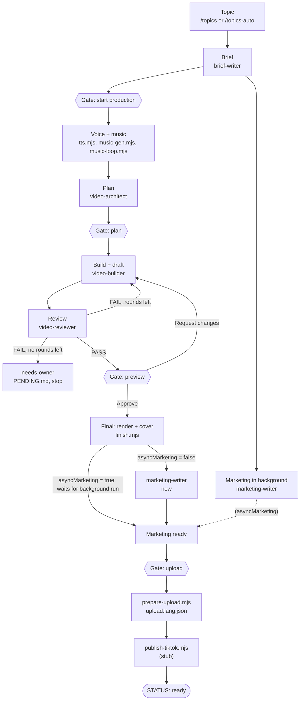
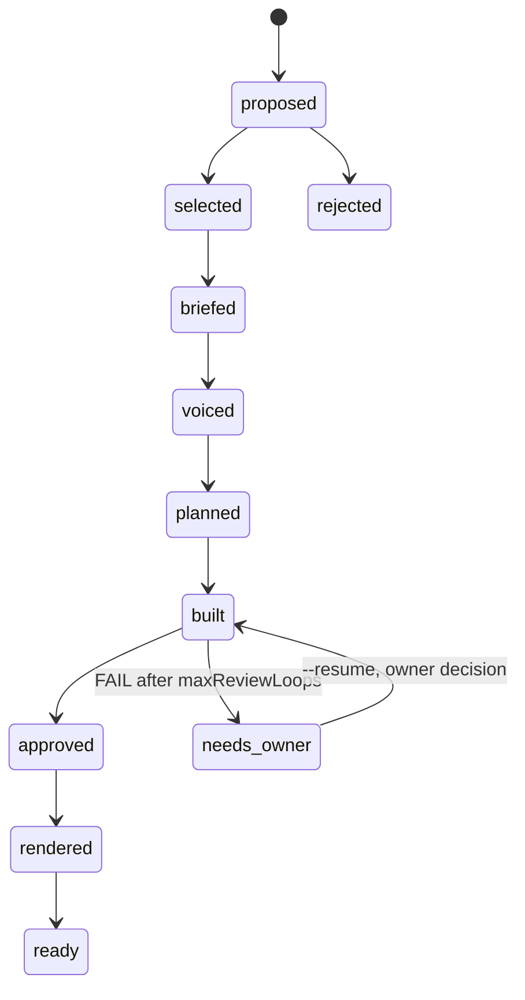
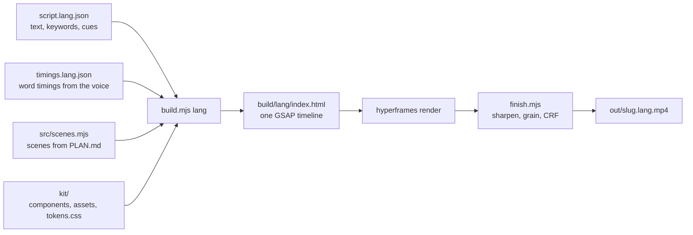

# TikTok Videomaker

A **Claude Code** project that turns a topic ("igloo", "katana", "yakhchal", "roman aqueduct") into a finished vertical video of **60–120 seconds** (MP4, 1080×1920, 30 fps) about how a simple invention, tool or structure works. Every design detail is shown as **problem → what breaks without it → solution**. Every video ends with the line "Now you know how to build a …".

You do only three things: pick a topic, run a command and approve the preview. Everything else — fact research, script, voiceover, edit plan, build, quality review, final render, cover, TikTok post copy and the upload file — is done by skills, agents and Node scripts.

> The project **cannot** publish to TikTok automatically (there is only a `publish-tiktok` stub): it prepares everything for a manual upload.

> **This repository ships only the tool.** Your videos (`videos/<slug>/`), your topic registry (`topics.md`) and your personal settings (`config.json`) are local and git-ignored. A fresh clone starts with no topics and no videos.

## Contents
1. [What it does](#what-it-does)
2. [Quick start](#quick-start)
3. [How to use it](#how-to-use-it)
4. [How it works (diagrams)](#how-it-works-diagrams)
5. [Commands (skills)](#commands-skills)
6. [Agents](#agents)
7. [Tools in `tools/`](#tools-in-tools)
8. [Configuration: `config.json`](#configuration-configjson)
9. [Gates, statuses, resume](#gates-statuses-resume)
10. [Music](#music)
11. [Style: `look` and `/style-preview`](#style-look-and-style-preview)
12. [Marketing and the upload file](#marketing-and-the-upload-file)
13. [Logs](#logs)
14. [Repository layout](#repository-layout)
15. [Customising it](#customising-it)
16. [Troubleshooting](#troubleshooting)
17. [Documentation](#documentation)

---

## What it does

| Stage | What happens | Output |
| --- | --- | --- |
| Topics | 10 new topics with scores (1–5) and a Wikipedia link | `topics.md` |
| Brief | Fact research with sources, storyboard, a script for each language | `BRIEF.md`, `script.<lang>.json`, `voiceover.<lang>.txt` |
| Voice and music | ElevenLabs with word timestamps (or your own mp3); ElevenLabs Music generates background music for each video, looped seamlessly and ducked under the voice | `audio/voice.<lang>.mp3`, `timings.<lang>.json`, `audio/music.loop.<lang>.mp3` |
| Plan | Technical plan: scenes, assets, components, commands | `PLAN.md` |
| Build | Scenes in HyperFrames (HTML + GSAP) driven by the script data and voice timings | draft in `out/draft/` |
| Review | The reviewer checks draft frames and writes a PASS/FAIL verdict | `REVIEW.md` |
| Preview | You watch the draft and approve it or request changes | — |
| Final | Render, cover, final finishing (sharpen, grain, vignette) | `out/<slug>.<lang>.mp4`, `out/cover.<lang>.png` |
| Marketing | Caption, hashtags, keywords, pinned comment | `marketing.<lang>.json`, `MARKETING.md` |
| Upload | A file in TikTok Content Posting API format | `out/upload.<lang>.json` |

Key principles:
- **All on-screen text** comes from `script.<lang>.json` and **all timings** from `timings.<lang>.json` (from the voice); nothing is hard-coded in markup. A new language is just new data, no code changes.
- **Facts have sources** in `BRIEF.md`; explanations not found in sources are labelled as engineering explanations.
- **One style** for every video: flat-shaded low-poly, side cross-section view, cumulative frame, block-figure characters, a "ghost of failure" before each solution (see `docs/style-guide.md`).
- **The ElevenLabs key** lives only in `.env`; Claude never reads it, scripts load it via `node --env-file=.env`.

---

## Quick start

### 1. Install (once)
- **Node.js 22+** and **FFmpeg** (`node -v`, `ffmpeg -version`, `ffprobe -version`). Python is not needed.
- **Claude Code**.
- The **HyperFrames** plugin:
  ```bash
  claude plugin marketplace add heygen-com/hyperframes
  claude plugin install hyperframes@hyperframes
  ```
  (or inside Claude Code: `/plugin marketplace add heygen-com/hyperframes`, then `/plugin install hyperframes@hyperframes`). The CLI is pinned to `hyperframes@0.9.36`.
- `gh`, optionally, to push the repository to GitHub.

### 2. Setup
1. Clone the repository and open it in a terminal.
2. Create `.env`: copy `.env.example` → `.env` and set `ELEVENLABS_API_KEY=...` (ElevenLabs → profile → API Keys). The file is git-ignored.
3. Create your local config: copy `config-template.json` → `config.json` and set a `voice_id` for each language in `tts.voices` (ElevenLabs → Voices → a voice → "Copy voice ID"). `config.json` is git-ignored; keys you leave out fall back to the template.
4. Music: by default ElevenLabs Music generates it for each video (see [Music](#music)); no extra setup. Optionally put `assets/music.mp3` there as a fallback if generation fails, or for `music.source: "file"` mode.
5. Turn on key-leak protection:
   ```bash
   git config core.hooksPath .githooks
   ```
   The `.githooks/pre-commit` hook blocks a commit that contains an `sk_…` key or a `.env` file.
6. Run `claude` in the project folder. The video template (`videos/_template/`) is already in the repo; `BOOTSTRAP_PROMPT.md` is only needed to rebuild the template from scratch. `topics.md` is created from `topics-template.md` the first time you run `/topics`.

### 3. First video
```text
/generate
```
The skill shows 10 topics, you pick a number, and it takes the video through every stage, stopping only where your approval is needed.

---

## How to use it

**Simplest — one command:**

| What you want | Command |
| --- | --- |
| A whole video, from topic to upload file | `/generate` |
| The same with no questions (every approval gate is open for this run only) | `/generate --unattended` |
| Continue an interrupted video (token limit, crash, stop) | `/generate --resume` or `/generate --resume <slug>` |

**Step by step (manual blocks):**

| Step | Command | What it does |
| --- | --- | --- |
| 1 | `/topics` | 10 topics with scores and links; reply `3` or `3 uk ru` |
| 2 | `/brief <topic> [uk] [ru]` | brief and scripts (starts by itself after you pick a topic) |
| 3 | `/produce <slug> [langs]` | voice → plan → build → review → preview → final → marketing → upload file |

**Other scenarios:**
- **Add a language to a finished video:** `/brief <slug> uk`, then `/produce <slug> uk`.
- **Your own voiceover, no API:** put `videos/<slug>/audio/voice.<lang>.mp3` in place before `/produce`; timings come from the pauses in the audio.
- **Redo the voiceover:** `/produce <slug> --revoice` (spends ElevenLabs credits).
- **Generate new music:** `/produce <slug> --remusic` (new track, spends ElevenLabs credits; ignored with `--resume`).
- **Topic registry:** reply `reject 2,5` to `/topics` to remove topics for good.
- **Bring component improvements back into the template:** `/promote <slug>`.
- **Tune the look without rendering a video:** `/style-preview` (see [below](#style-look-and-style-preview)).
- **Pick a topic automatically:** `/topics-auto` (takes the topic with the highest total score and briefs it right away).

Finished files are in `videos/<slug>/out/`: `<slug>.<lang>.mp4`, `cover.<lang>.png`, `upload.<lang>.json`; the post text, hashtags and pinned comment are in `videos/<slug>/MARKETING.md`.

---

## How it works (diagrams)

### Overall pipeline


### Who does what

The main session only orchestrates: it runs scripts, delegates work to agents, checks their files and asks the owner. Agents never ask questions or call each other: every hand-off is a **file** (`BRIEF.md` → `PLAN.md` → code → `REVIEW.md`).

### Video statuses

The status is written to `videos/<slug>/STATUS` and to `topics.md`. `needs_owner` in the diagram is the `needs-owner` status.

### How data becomes a video

Cue words from the script (for example "wall" → `wall-rise`) tie animations to words in the voiceover, so sync works in every language.

### Style pipeline


---

## Commands (skills)

Skills live in `.claude/skills/<name>/SKILL.md` and are invoked as `/name`.

| Command | Arguments | What it does |
| --- | --- | --- |
| `/generate` | `[--unattended] [--remusic] [--resume [<slug>]]` | One video from topic to `ready`: topic → brief → marketing in background → gate → voice → plan → build ⇄ review → preview → final → marketing → upload file. Stops only at gates that `config.json` leaves closed. |
| `/produce` | `<slug> [langs] [--revoice] [--remusic] [--unattended] [--resume]` | Production of a finished brief (steps P1–P9; `/generate` uses the same logic). |
| `/brief` | `<topic or slug> [uk] [ru]` | Creates `videos/<slug>/` from the template, calls `brief-writer`, checks with `validate.mjs`. Modes: new video, add a language, revise from owner notes. |
| `/topics` | `[theme or category]` | 10 new topics (max 2 per category), scored 1–5 on hook / visual / depth / facts / variety, with a Wikipedia link (Wiki column). Reply with a number, a name (+ languages) or `reject 2,5`. |
| `/topics-auto` | `[theme or category]` | The same, but picks the topic with the highest total itself (on a tie, the least recently used category) and records `auto-picked: reason` in `topics.md`. |
| `/promote` | `<slug>` | Shows changes to `kit/` and `build.mjs` in a video compared with the template, asks which to move into `videos/_template/`, commits `template: promote from <slug>`. |
| `/style-preview` | `[key=value …] [key=v1,v2,v3] [--neutral] [--apply] [--guides]` | Stills of the style specimen (day, night, tense) for the `look` values, compared with the previous preview. No video is rendered. |

`/generate`, `/promote` and `/style-preview` are run only by the owner. `/topics`, `/topics-auto`, `/brief` and `/produce` can also be called from `/generate`, so they do not set `disable-model-invocation`. `/promote` is never called in an `--unattended` run; its "Auto mode" (only general, compatible changes, no questions) runs at the end of `/produce` when `autoPromoteKit` = `true`.

---

## Agents

Agents live in `.claude/agents/`. They **never ask questions**; they write everything to files.

| Agent | Model | Role | Writes |
| --- | --- | --- | --- |
| `brief-writer` | Opus | Researches the topic on the web (≥ 2 independent sources per fact), builds the problem → solution chain, writes the storyboard and scripts | `BRIEF.md`, `script.<lang>.json`, `voiceover.<lang>.txt` |
| `video-architect` | Opus, medium, no shell | Technical build plan (scenes per beat, assets, components, commands from `TEMPLATE.md`) | `PLAN.md` |
| `video-builder` | Sonnet, medium | Implements the plan in HyperFrames; modes `build`, `fix`, `final` | `src/`, `build/`, `out/draft/`, `out/` |
| `video-reviewer` | Sonnet, medium | Checks draft frames against a checklist (technical specs, beat frames, captions, safe zones, colours) | `REVIEW.md` (PASS/FAIL) |
| `marketing-writer` | Sonnet, low, no web or shell | Caption, hashtags, keywords, pinned comment, Shorts/Reels variants | `marketing.<lang>.json`, `MARKETING.md` |

---

## Tools in `tools/`

Node 22 with no npm dependencies (only `ffmpeg`/`ffprobe` are needed). Run everything from the repository root.

| Script | Purpose |
| --- | --- |
| `tts.mjs <slug> <lang> [--force]` | ElevenLabs voiceover with character timestamps; reuses saved audio if the text has not changed. Run: `node --env-file=.env tools/tts.mjs …` |
| `timings-from-silence.mjs <slug> <lang>` | Timings from the pauses in your own mp3 (no API) |
| `music-gen.mjs <slug> [--force]` | Generates the video's music with ElevenLabs Music: prompt = `music.promptTemplate` + the topic from `music.json`. One track per video, reused without credits; any API error → `music: fallback`, exit code 0 (non-blocking). Run: `node --env-file=.env tools/music-gen.mjs …` |
| `music-loop.mjs <slug> <lang> [--no-duck]` | Loops the music seamlessly to the video length (source: `audio/music.source.mp3`, then `assets/music.*`, then no music), adds fades, volume and ducking under the voice |
| `fake-voice.mjs <slug> <lang>` | A silent "voiceover" with synthetic timings for tests without credits (`source: fake`, never used in a final) |
| `new-video.mjs <slug>` | Creates `videos/<slug>/` from the template without generated folders (build, out, audio, showcase, style); used by `/brief`, no `rm` |
| `validate.mjs <slug>` | Checks scripts, timings, and `marketing.*.json` and `upload.*.json` when present. For `en`, an error if words > (target − 8) × 2.4 |
| `script-hash.mjs <slug> <lang>` | sha256 of the whole voiceover text (to detect stale marketing) |
| `prepare-upload.mjs <slug> <lang>` | Builds `out/upload.<lang>.json`; exit code 3 = marketing is stale (text changed) |
| `publish-tiktok.mjs <slug> <lang>` | Stub: checks `upload.*.json`; with `publish: "off"` reports that the file is ready |
| `finish.mjs <file> [<output>]` | Final finishing of a video or PNG from `look` (sharpen, grain, vignette, CRF, x264 tune) |
| `apply-look.mjs [--set k=v] [--neutral]` | Generates `kit/tokens.css` from `tokens.base.css` and `config.look` |
| `style-preview.mjs …` | Engine of the `/style-preview` skill |
| `wiki-lookup.mjs "<title>" [--lang en]` | Looks up a Wikipedia article, prints `{title, url, found}` |
| `log.mjs` | Appends a line to the video log or the run log (the script sets the time) |
| `lib.mjs` | Shared helpers (not run directly) |

---

## Configuration: `config.json`

`config-template.json` holds the defaults and is in the repo. `config.json` is **your local file** (git-ignored). Scripts read `config.json` **layered over the template**: a key missing from `config.json` falls back to the template value, and if `config.json` does not exist the template is used as is. So start by copying the template and keep only what you change; add new keys to the template.

### `languages`
| Key | Value | What it changes |
| --- | --- | --- |
| `primary` | `en` | Primary language: briefs and plans are written in it, drafts are reviewed in English |
| `supported` | `["en","uk","ru"]` | Languages allowed in `script.<lang>.json` |

### `tts` — voiceover (ElevenLabs)
| Key | Default | What it changes |
| --- | --- | --- |
| `provider` | `elevenlabs` | Voice provider |
| `model` | `eleven_multilingual_v2` | Model; supports English, Ukrainian, Russian |
| `outputFormat` | `mp3_44100_128` | Audio format |
| `voices` | placeholder `REPLACE_WITH_YOUR_ELEVENLABS_VOICE_ID` in `config-template.json` | Voice per language — **set your own** `voice_id` in `config.json` (the script stops while the value starts with `REPLACE`) |
| `voiceSettings` | stability 0.5, similarity_boost 0.75, style 0, use_speaker_boost true, speed 1 | Voice settings. `speed` barely shortens the audio for this voice: if a video is too long, shorten the script |
| `maxRetries` | `2` | How many times to retry a failed request |

### `timing` — duration and timings
| Key | Default | What it changes |
| --- | --- | --- |
| `minDurationSec` / `maxDurationSec` | 60 / 120 | Video length limits; a video over the maximum is not rendered |
| `tailSec` | 1.5 | Pause after the voiceover until the end of the video |
| `silenceDetect` | noiseDb −35, minSilenceSec 0.25 | Pause detection for your own mp3 (no API) |

### `music`
| Key | Default | What it changes |
| --- | --- | --- |
| `source` | `elevenlabs` | Where music comes from: `elevenlabs` (generated per video), `file` (no generation: your `audio/music.source.mp3` or `assets/music.*`), `off` (no music) |
| `model` | `music_v2` | ElevenLabs Music model (`music_v1` is deprecated and will be removed in January 2027) |
| `lengthSec` | 30 | Length of the generated track, s |
| `loopCrossfadeSec` | 2 | Crossfade of the end into the start for a seamless loop, s |
| `volume` | 0.12 | Music volume under the voice |
| `fadeInSec` / `fadeOutSec` | 1 / 2 | Fade in and fade out |
| `ducking.enabled` | `true` | Lower the music while the voice is speaking |
| `ducking.duckDb` | −8 | How many dB, on average, the music drops under the voice |
| `ducking.attackMs` / `releaseMs` | 150 / 600 | How fast the music drops and comes back |
| `promptTemplate` | prompt text with `{{topic}}` | Shared part of the prompt for every video; `{{topic}}` is replaced by the topic from `music.json` |

### `pipeline` — automation and gates
| Key | Default | What it changes |
| --- | --- | --- |
| `defaultLanguages` | `["en"]` | Languages for `/generate` and `/topics-auto` |
| `autoSelectTopic` | `false` | `true` — the skill picks the topic with the highest score, no question |
| `autoStartProduction` | `false` | `true` — the voiceover starts right after the brief |
| `autoApprovePlan` | `false` | `true` — continues after `PLAN.md` without approval |
| `maxReviewLoops` | `2` | How many review rounds can trigger fixes (the reviewer always runs at least once) |
| `autoApprovePreview` | `false` | `true` — final render without your preview, **only** if the last review = PASS |
| `autoTrimOverlong` | `true` | `--unattended` only: a voiceover over 120 s is shortened automatically once (ElevenLabs credits are spent a second time); `false` — stop with `needs-owner` |
| `autoPrepareUpload` | `false` | `true` — prepares `upload.<lang>.json` without asking |
| `asyncMarketing` | `true` | The marketing agent starts in the background right after the brief |
| `autoPromoteKit` | `false` | `true` — moves component improvements into the template by itself |
| `publish` | `"off"` | Only `off` for now (planned: draft / private / public) |

`false` = the skill asks you (**Approve / Request changes**).

### `marketing` — TikTok post settings
| Key | Default | What it changes |
| --- | --- | --- |
| `privacyLevel` | `SELF_ONLY` | Post visibility (`SELF_ONLY`, `MUTUAL_FOLLOW_FRIENDS`, `FOLLOWER_OF_CREATOR`, `PUBLIC_TO_EVERYONE`) |
| `disableDuet` / `disableStitch` / `disableComment` | `false` | Disable duets, stitches, comments |
| `isAigc` | `true` | "AI-generated" label |
| `alsoShortsAndReels` | `true` | Also write variants for Shorts and Reels |

### `look` — appearance
See [Style](#style-look-and-style-preview).

---

## Gates, statuses, resume

**Approval gates** — five places where the pipeline can stop and ask you:

| Gate | Flag | Where |
| --- | --- | --- |
| topic | `autoSelectTopic` | `/generate`: `true` → `/topics-auto`, `false` → `/topics` and your pick |
| production | `autoStartProduction` | after the brief, before the voiceover (so credits are not spent needlessly) |
| plan | `autoApprovePlan` | after `PLAN.md` |
| preview | `autoApprovePreview` | after PASS, before the final render |
| upload | `autoPrepareUpload` | after the final and marketing |

- Flag `true` → the gate passes by itself; `false` → an **Approve / Request changes** question.
- **`/generate --unattended`**: for this run only, every approval gate counts as `true`. Nothing is written to `config.json`; `publish` and `autoPromoteKit` always come from `config.json`.
- **Hard rule** (no flag and no `--unattended` bypasses it): if the last review is **FAIL** after `maxReviewLoops`, the pipeline stops, `STATUS` = `needs-owner`, the reason is in `videos/<slug>/PENDING.md`.
- **`--resume [<slug>]`** continues from where it stopped (no slug — the most recent unfinished video). Finished steps are not repeated and ElevenLabs credits are not spent again. For `needs-owner` the skill shows the open issues and asks **Approve anyway / Request changes**; with `--unattended` such videos never pass automatically.
- Before finishing or stopping, the orchestrator waits for background agents (async marketing).
- **`autoPromoteKit` with `--unattended`:** `--unattended` does not change it; the value always comes from `config.json`. If `true`, at the end of `/produce` it moves only general, compatible `kit/` changes into the template (no questions; topic-specific ones stay); if `false`, it only suggests `/promote <slug>` when `KIT_CHANGES.md` is not empty. Blocking errors (missing key, validation, tool failure) write `PENDING.md`, do not change `STATUS` and stop the run; `--resume` retries the failed step. A voiceover longer than 120 s is shortened automatically once (`brief-writer` rewrites the script, then a new voiceover is made) when `pipeline.autoTrimOverlong` = `true` (default); **this spends ElevenLabs credits a second time** — the first pass is already paid for. With `autoTrimOverlong` = `false` the run stops with status `needs-owner` and the reason in `PENDING.md` instead.

**Review loop:** the reviewer always runs at least once; on FAIL the builder fixes and the reviewer checks again (up to `maxReviewLoops` fixes). After your preview, small changes (text, position, colour, speed) are done by the builder, structural ones (add/remove scenes, change the concept) by the architect first, then the builder.

---

## Music

Each video gets **its own background music**, generated by ElevenLabs Music. It is one instrumental track per video (not per language), which is then looped to the video length for each language and ducked under the voice.

- **Prompt** = `config.json → music.promptTemplate`, with `{{topic}}` replaced by the `topic` field from `videos/<slug>/music.json`. `music.json` is written by `brief-writer` (up to 25 words: what the video is about, era and region, 1–2 characteristic instruments, e.g. `Ancient Persian desert ice-house, ~400 BC, Iranian plateau; santur, ney`); `validate.mjs` checks that it exists and has ≤ 25 words.
- **Modes** (`music.source`): `elevenlabs` — generated per video; `file` — no generation, uses your `videos/<slug>/audio/music.source.mp3` or `assets/music.mp3`; `off` — no music.
- **Changing the sound for all videos:** edit `promptTemplate` in `config.json` (style, instruments, tempo; the phrase about a seamless loop matters). For one video, edit `music.json` and run `/produce <slug> --remusic`.
- **New music:** `--remusic` forces a new track and spends credits. Without the flag the existing `audio/music.source.mp3` is reused; `--resume` never regenerates music.
- **Seamless loop:** the end of the track crossfades into its start (`loopCrossfadeSec`), so the repeat is inaudible; then fade in/out and `volume`.
- **Ducking:** `ducking.duckDb` (default −8 dB), `attackMs`, `releaseMs`; turn off with `ducking.enabled: false`. The music drops under the voice and comes back in pauses.
- **Non-blocking:** if the API refuses (key, plan, limit, outage), `music-gen` writes the reason and `music: fallback`, and `music-loop` uses `assets/music.mp3` or runs without music. Everything is written to the video log.
- Files: `music.json`, `audio/music.source.mp3`, `audio/music.meta.json` (prompt, model, length, generation time) and `audio/music.loop.<lang>.mp3`.

---

## Style: `look` and `/style-preview`

You tune the picture on **stills**, without rendering a video. The skill builds the "specimen" (`videos/_template/style/specimen/`: every asset and overlay in three states — day, night, tense), takes frames, applies the same final finishing (sharpen, grain, vignette) and saves them to `videos/_template/style/previews/<date_time>/` (`day.png`, `night.png`, `tense.png`, `look.json`, `compare.png` — previous on the left, new on the right). The `previews` folder is git-ignored.

| What | Command |
| --- | --- |
| Frames for the current `config.json → look` | `/style-preview` |
| Base (original) palette | `/style-preview --neutral` |
| Try values without saving | `/style-preview saturation=1.2 depthFade=0.5` |
| Compare several values (column = value, rows day and night) | `/style-preview lightness=1.0,1.1,1.2` |
| Save to `config.json` and commit the regenerated tokens | `/style-preview saturation=1.2 --apply` |
| Show safe-zone guides | `/style-preview --guides` |

| Key | Range | Default | What it changes |
| --- | --- | --- | --- |
| `saturation` | 0–2 | 1.10 | scene colour saturation |
| `lightness` | 0.5–1.5 | 1.10 | scene colour brightness |
| `maxLightness` | 0.5–1 | 0.94 | brightness ceiling (snow stays distinct from white text) |
| `contrast` | 0.5–1.5 | 1.0 | scene contrast |
| `temperature` | −1…1 | 0 | cooler / warmer |
| `faceShading` | 0–1 | 0.5 | difference between light and dark faces (0.5 = original) |
| `outline` | 0–6 | 0 | outline thickness around polygons, px |
| `shadowOpacity` | 0–1 | 0.25 | shadows under objects |
| `depthFade` | 0–1 | 0.3 | distant layers fade into the sky |
| `nightDarkness` / `nightBlue` | 0–0.8 / 0–1 | 0.35 / 0.5 | how much darker / bluer night is |
| `uiScale` | 0.7–1.4 | 1.0 | size of chips, callouts, scales |
| `captionScale` | 0.7–1.3 | 1.0 | caption size |
| `captionShadow` | 0–2 | 0.6 | caption shadow |
| `sharpen` | 0–1.5 | 0.3 | sharpening in the final render (0 = off) |
| `crf` / `x264Tune` | 10–30 / animation… | 18 / animation | quality and codec tune of the final |
| `grain` / `vignette` | 0–1 | 0 / 0 | grain / vignette (0 = off) |

How it is set up:
- `kit/tokens.base.css` is the original palette (tools never change it). `kit/tokens.css` is **generated** by `apply-look.mjs` from it and `config.look`. Do not edit `tokens.css` by hand: change `config.json` or run `/style-preview … --apply`.
- Meaningful UI colours (green, red, yellow, blue, orange "heat", white, muted) are not affected by `look`.
- Drafts have no final finishing; the final and the cover are finished automatically (`tools/finish.mjs`). Full description: `docs/style-guide.md` → "Look parameters".
- A new video takes the current `kit/tokens.css` from the template; finished videos have their own copy and do not change.

---

## Marketing and the upload file

- `marketing-writer` writes `marketing.<lang>.json` for each language (caption ≤ 2200 characters, ideally ≤ 300; 3–6 hashtags; 5–8 keywords; a pinned comment with a fact not in the video and the source name) and a shared `MARKETING.md` with a paste-ready caption and an upload checklist. Facts come only from `BRIEF.md`.
- The marketing file stores a **hash of the voiceover text**. If the text has changed, `prepare-upload.mjs` exits with code 3 ("stale marketing") and the marketing is regenerated.
- `prepare-upload.mjs` writes `out/upload.<lang>.json` with fields matching the TikTok Content Posting API (Direct Post): `post_info` (title, privacy_level, disable_duet/stitch/comment, video_cover_timestamp_ms, brand_content_toggle, brand_organic_toggle, is_aigc), `source_info`, video size and duration. The cover is taken from the middle of the climax beat. Schemas: `docs/marketing.schema.json`, `docs/upload.schema.json`.
- Publishing is off: `publish: "off"`. Upload the video by hand using `MARKETING.md`. The future API flow is described in the comment at the top of `tools/publish-tiktok.mjs`.

---

## Logs

Two logs, both append-only and both git-ignored. A line looks like `time | slug | step | result | details`; **the time is set by `tools/log.mjs`**, not by the model, and only skills (the orchestrator) write them, never agents.

| Log | Where | What it holds |
| --- | --- | --- |
| Video log | `videos/<slug>/logs/pipeline.log` | full history of one video: start and end of every step, gate decisions (auto / approved / changes), TTS characters per language, review verdict for each round, `needs-owner` stops, `--resume`, errors with text, output paths |
| Run log | `logs/runs.log` at the root | short: start and end of each command (`/generate`, `/produce`, `/brief`, `/topics`, `/topics-auto`, `/promote`, `/style-preview`) with slug, flags, final status and duration; events without a video folder use slug `-` |

Add a line by hand:
```bash
node tools/log.mjs <slug> <step> <result> "<details>"          # video log
node tools/log.mjs --run <command> <slug|-> <result> "<details>"  # run log
```

---

## Repository layout

```text
CLAUDE.md                 project rules for Claude Code
config-template.json      default settings (in the repo)
config.json               your settings on top of the template (local, not in git)
topics-template.md        empty topic registry (in the repo)
topics.md                 your topic registry: status, scores, links (local, not in git)
.env                      ElevenLabs key (not in git)
assets/                   optional music.mp3 — fallback music (not in git)
docs/                     PRD, ARCHITECTURE, style-guide, tech-requirements, storytelling,
                          brief-template, JSON schemas, example in examples/yakhchal/
tools/                    Node scripts (see above)
.claude/skills/           skills (commands)
.claude/agents/           agents
.claude/settings.json     permissions: node tools/*, ffmpeg, npx hyperframes …; reading .env is denied; `git push` allowed
.githooks/pre-commit      key-leak protection
logs/runs.log             run log (not in git)
videos/_template/         video template: HyperFrames project + kit + build.mjs + style specimen (in the repo)
videos/<slug>/            one video (local, not in git)
```

A video folder (all local, not in git):
```text
videos/<slug>/
  BRIEF.md  script.<lang>.json  voiceover.<lang>.txt   brief and text
  music.json                                           topic for the music prompt (≤ 25 words)
  timings.<lang>.json                                  timings (from the voice)
  PLAN.md  REVIEW.md  STATUS  PENDING.md               plan, review, status, stop reason
  KIT_CHANGES.md                                       kit changes worth moving into the template
  marketing.<lang>.json  MARKETING.md                  marketing
  src/scenes.mjs  kit/  build.mjs                      this video's scenes, kit copy, builder
  audio/  build/  review/  logs/                       voice (voice.*, music.source.mp3, music.meta.json,
                                                       music.loop.<lang>.mp3), builds, review frames, logs
  out/draft/  out/<slug>.<lang>.mp4  cover.<lang>.png  upload.<lang>.json   results
```

**What is shared and what is yours.** The repo holds only the tool: skills, agents, docs, scripts, the template and the reference example. Topics, briefs, scripts, videos and your voice IDs never go into git, so anyone can clone and use the tool without getting your content. If you want to back up your own content, keep it somewhere else (for example a separate private repo for `videos/` and `topics.md`).

---

## Customising it

| You want to … | What to do |
| --- | --- |
| Change the voice | Set a different `voice_id` in `config.json → tts.voices` |
| Change the default languages | `config.json → pipeline.defaultLanguages` (e.g. `["en","uk"]`); each language needs a `voice_id` in `config.json → tts.voices`; add a new language to `languages.supported` and `docs/script.schema.json` too |
| Get fewer questions | Turn on the `auto…` flags you need in `config.json → pipeline`, or run `/generate --unattended` |
| Allow public posts | `config.json → marketing.privacyLevel` (publishing is manual for now) |
| Tune colour, sharpness, grain | `/style-preview …`, then `--apply` (or edit `config.json → look`) |
| Change the base palette or sizes | Edit `videos/_template/kit/tokens.base.css`, then run `node tools/apply-look.mjs` |
| Add your own components and assets | Build them in a video (`videos/<slug>/kit/`), list them in `KIT_CHANGES.md`, move them into the template with `/promote <slug>` |
| Change the script rules | `docs/storytelling.md`, `docs/brief-template.md`, `docs/script.schema.json` |
| Change how skills or agents behave | Edit `.claude/skills/<name>/SKILL.md` or `.claude/agents/<name>.md` (read `docs/ARCHITECTURE.md` first) |
| Change the music | Shared style — `config.json → music.promptTemplate`; one video — `music.json` and `/produce <slug> --remusic`; your own music — `music.source: "file"` and `assets/music.mp3` (or `audio/music.source.mp3`); volume, ducking — `music.volume`, `music.ducking` |
| Update HyperFrames | The CLI is pinned to `hyperframes@0.9.36` (in `package.json` and the template scripts); change the version deliberately and check the build |
| Move an existing video to a newer template | Copy the files you need from `videos/_template/` by hand (finished videos are deliberately never changed automatically) |

Rules worth knowing before you change anything: the video stack is **HyperFrames** only; Python is not used; the format is MP4 1080×1920, 30 fps, H.264 + AAC, 60–120 s; the ElevenLabs key is never printed, logged or committed; only changes to the tool are committed — never `.env`, audio, renders, `config.json`, `topics.md` or video folders.

---

## Troubleshooting

- **The voiceover is longer than 120 s** — shorten the script (English budget: words ≤ (target − 8) × 2.3; `validate.mjs` errors above × 2.4). Changing `speed` in the voice settings does not help.
- **No `.env` and no audio** — add `ELEVENLABS_API_KEY` to `.env` or put `voice.<lang>.mp3` in `videos/<slug>/audio/`.
- **"no voice id" error** — copy `config-template.json` to `config.json` and set your `tts.voices`.
- **A video stopped with status `needs-owner`** — read `videos/<slug>/PENDING.md`, then run `/generate --resume <slug>`.
- **`prepare-upload` exited with code 3** — the text changed after marketing; the skill regenerates marketing once by itself (or run `marketing-writer`).
- **An interrupted video (token limit etc.)** — `/generate --resume`.
- **No music, or music from `assets/`** — check the video's `logs/pipeline.log`: `music: fallback — <reason>` means ElevenLabs Music refused (key, plan, limit). Fix the cause and run `/produce <slug> --remusic`.
- **ElevenLabs free tier** — 10,000 characters a month (about 5 language versions of a video); for testing only, commercial use is not allowed on Free.
- **A script cannot see the key** — run it via `node --env-file=.env tools/tts.mjs …`; Claude does not read `.env` (on purpose).

---

## Documentation

| File | About |
| --- | --- |
| [`CLAUDE.md`](CLAUDE.md) | project rules and the command table |
| [`docs/PRD.md`](docs/PRD.md) | what the system must do (requirements, acceptance criteria) |
| [`docs/ARCHITECTURE.md`](docs/ARCHITECTURE.md) | components, data flow, file contracts, gates, logs; **read before changing skills, agents or tools** |
| [`docs/style-guide.md`](docs/style-guide.md) | visual style, palette, captions, `look` parameters |
| [`docs/tech-requirements.md`](docs/tech-requirements.md) | format, duration, safe zones, i18n, audio |
| [`docs/storytelling.md`](docs/storytelling.md) | narrative rules and techniques, topic categories |
| [`docs/brief-template.md`](docs/brief-template.md) | exact structure of `BRIEF.md` |
| [`docs/script.schema.json`](docs/script.schema.json), [`marketing.schema.json`](docs/marketing.schema.json), [`upload.schema.json`](docs/upload.schema.json) | JSON file contracts |
| [`docs/examples/yakhchal/`](docs/examples/yakhchal/) | reference brief and script |
| [`videos/_template/TEMPLATE.md`](videos/_template/TEMPLATE.md) | how the template works, build and render commands |
| [`videos/_template/kit/README.md`](videos/_template/kit/README.md) | kit components and assets |
